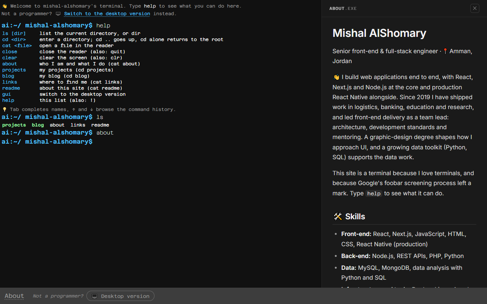
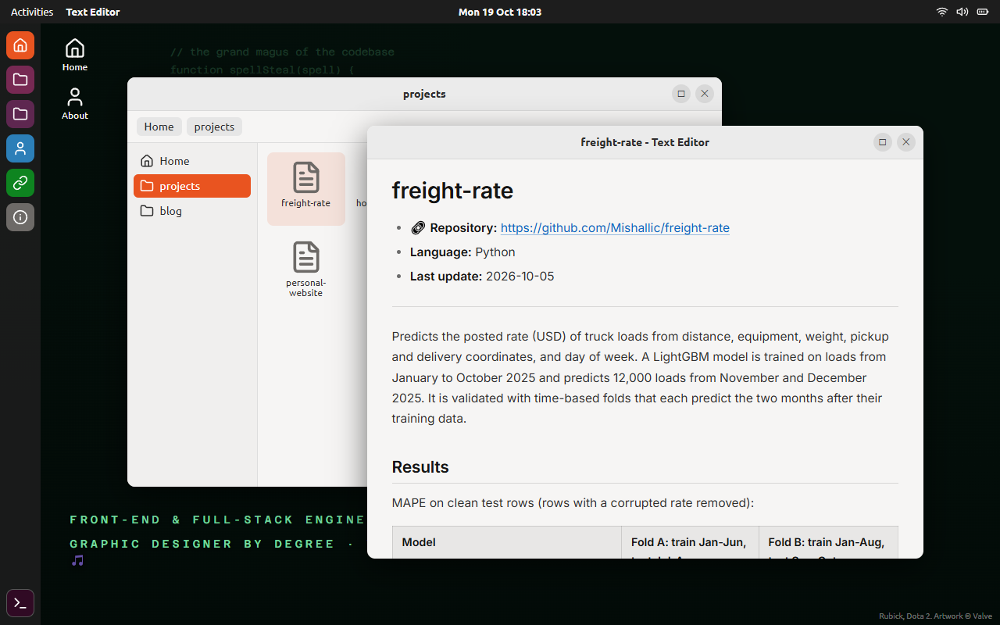
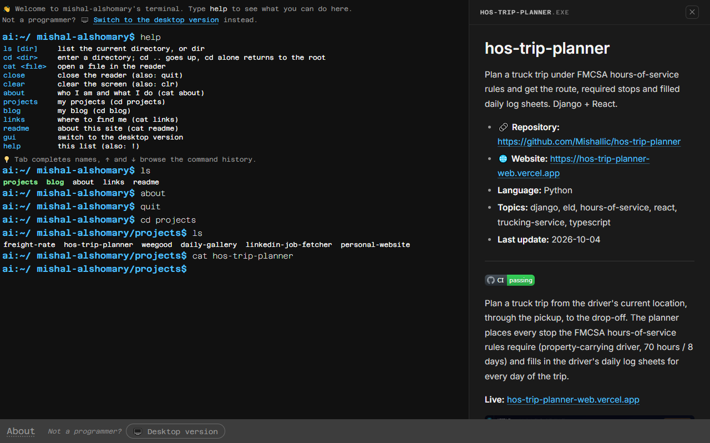
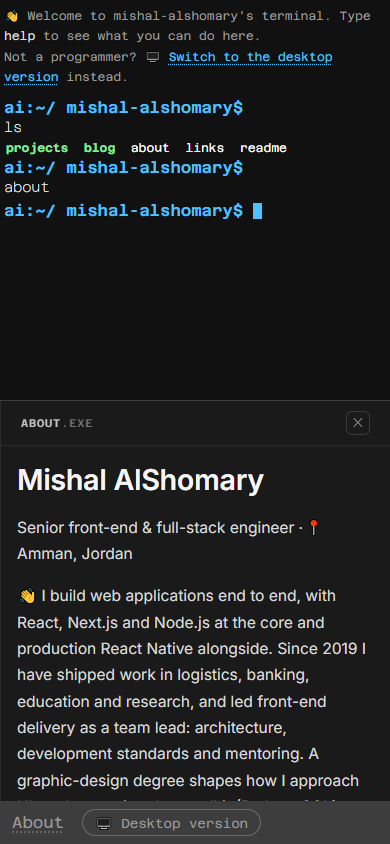

# personal-website

My portfolio, with a terminal interface. 🖥️ Visit it at **[personal-website-blue-nu-23.vercel.app](https://personal-website-blue-nu-23.vercel.app)**.

It works like a Linux shell: `ls`, `cd`, `cat`, Tab completion and ↑ / ↓ history. Type `help` for the full list.
Not a programmer? A small Ubuntu-like desktop shows the same content with a Files window and a text editor,
one click away in the footer.

## 📸 Screenshots

| Terminal | Desktop mode |
|---|---|
|  |  |

| Reading a project | On a phone |
|---|---|
|  |  |

## ✨ What it does

- **Terminal.** A prompt with a blinking block cursor, a bounded command history, Tab completion that only
  offers what the command can act on, and `ls` that colours folders the Ubuntu way.
- **Commands.** `ls`, `cd`, `cat`, `close`, `clear`, `help`, plus shortcuts `about`, `projects`, `blog`,
  `links`, `readme` and `gui`. Every command has a one-line description in `help`.
- **Reader.** Files open in a side panel with proper reading typography (Inter, a measured line width,
  styled headings, tables and code). It renders markdown.
- **Desktop mode.** Top bar with a clock, a dock, a Files window that browses the same directory tree,
  and a Text Editor window for files. The wallpaper is one of two Rubick images, picked per visit.
- **Content from GitHub.** The `projects` directory is generated from the repositories pinned on my
  profile, README included, so the site works without a database.
- **Responsive.** The reader stacks under the terminal on phones; the desktop fills the screen.

## 🧱 Stack

| Part | What |
|---|---|
| `frontend/` | React (Create React App), Redux Toolkit, plain CSS, react-markdown + remark-gfm |
| `backend/` | Node.js, Express, MySQL (mysql2). Serves `/projects`, `/blogs` and `/log` |
| `api/` + `vercel.json` | Vercel deployment: the frontend as a static site, the backend as a serverless function |
| `scripts/` | Content tooling (the pinned-projects generator) |
| `docker-compose*.yml` | Local full stack: frontend, API, MySQL and adminer |

### How it fits together

- **CLI** (`features/CLI`): the input line and the log. Every keystroke lands here; submitted lines go to
  the command processor.
- **Command processor** (`features/CMDProcessor`): parses the line, resolves it against the directory tree
  and dispatches store actions.
- **Store** (`store/`): the directory tree, working directory, command history, reader state and the
  terminal/desktop mode. Database rows are merged over the bundled content at runtime.
- **Reader** and **GUI** (`features/Reader`, `features/GUI`): two presentations of the same store.

## 🚀 Run it locally

**Full stack with Docker Compose** (frontend on :3000, API on :8000, MySQL on :3308, adminer on :8080):

```sh
cp env_file_example env_file                 # MySQL credentials
cp backend/.example.env backend/.env         # API settings, DB_HOST=mysql inside compose
docker compose -f docker-compose.local.yml up --build
```

**Frontend only** (no database: the blog stays empty, projects come from the bundled list):

```sh
cd frontend && npm install && npm start
```

**Backend only** against an existing MySQL:

```sh
cd backend && npm install && cp .example.env .env   # edit DB_* in .env
npm start
```

**Tests:** `cd frontend && CI=true npm test` (19 tests across the CLI, the store and the desktop).

## ☁️ Deploy on Vercel

The repo root is the Vercel project root. `vercel.json` builds `frontend/` into a static site and exposes
`backend/app.js` through `api/index.js`; rewrites map `/projects`, `/blogs` and `/log` to it.

1. Import the repository on vercel.com, or run `vercel` in the repo root.
2. Add the environment variables from `backend/.example.env` to the project (`DB_HOST`, `DB_PORT`,
   `DB_USER`, `DB_PASSWORD`, `DB_DATABASE`), pointing at a MySQL instance reachable from Vercel. Without
   them the site still deploys; the API answers 500 for database-backed routes and the blog stays empty.
3. Deploy. Production deployments build from `main`.

## ✍️ Editing the content

| What | Where |
|---|---|
| `about`, `links`, `readme` pages | `frontend/src/content/about.js`, `links.js`, `readme.js` (markdown strings) |
| `projects` | `frontend/src/content/projects.json`, generated from the pinned repos (see below) |
| Blog posts | the `blog` table in MySQL (`name`, `content`) |
| Colours | CSS variables at the top of `frontend/src/index.css` |
| Icons | rendered from `frontend/public/icon.svg` |
| Wallpapers | `frontend/public/wallpaper/`, listed in `frontend/src/features/GUI/Wallpaper.js` |

Refresh the pinned projects (metadata and README of each pinned repository):

```sh
GITHUB_TOKEN=<token> node scripts/pinned-projects.js Mishallic
```

The token is optional but avoids GitHub's limit of 60 anonymous requests per hour.

## 🙏 Credits

- Rubick artwork © Valve (Dota 2), used on the desktop wallpaper.
- Fonts: Azeret Mono, Inter and Ubuntu via Google Fonts.
